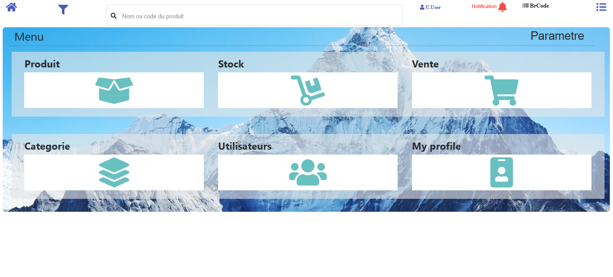
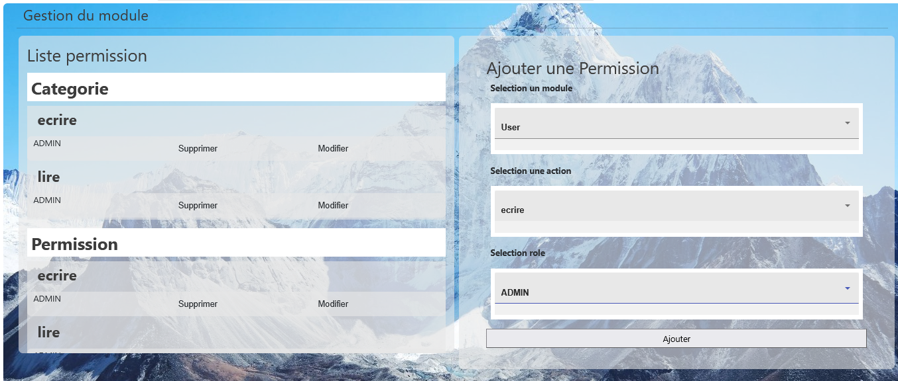
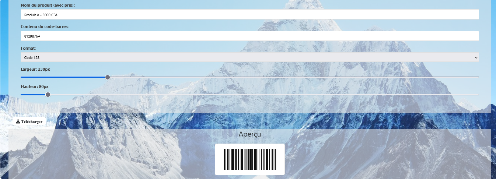
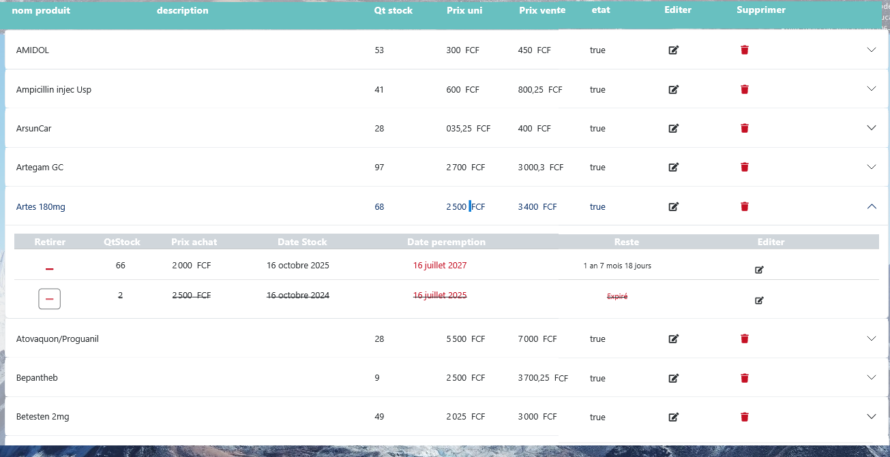
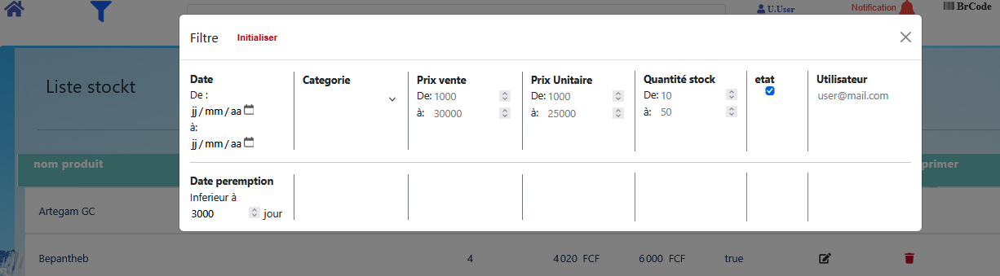
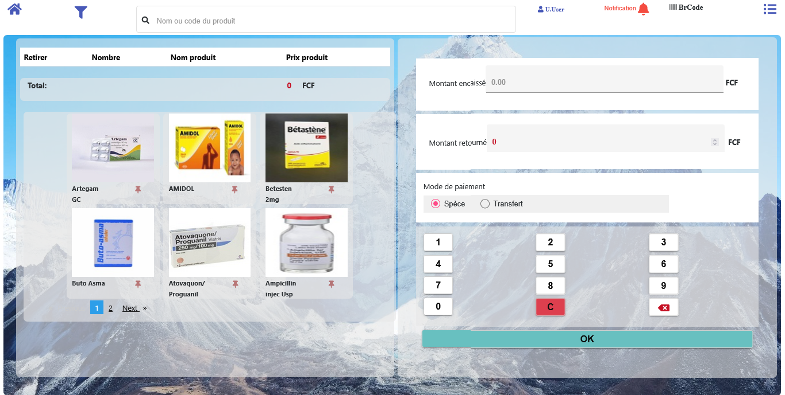
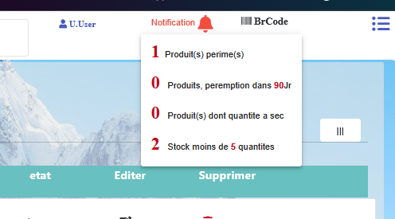
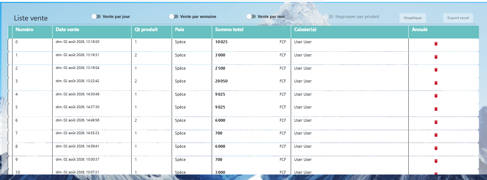
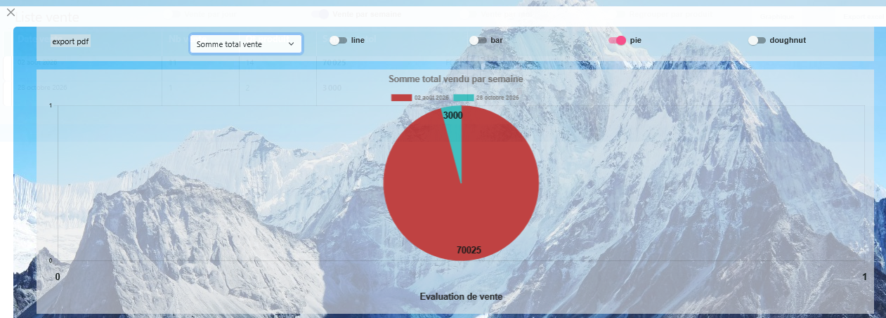
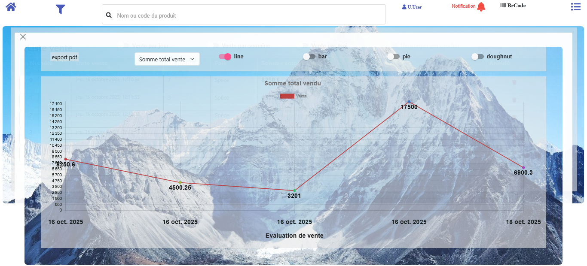

# GesAPP

**Gestion de stock et de vente**, conçue à l'origine pour les produits pharmaceutiques : les données restent en local, sur votre machine.

GesAPP s'installe en quelques clics, démarre comme un service Windows et s'utilise depuis un simple navigateur.

## Stack technique

- Backend : Spring Boot
- Frontend : Angular
- Base de données : MySQL (via XAMPP)
- En production, serveur et client sont compactés en **une seule application**.

## Installation

1. Téléchargez l'installateur de GesAPP.
2. Lancez-le : l'application, XAMPP et la base MySQL sont installés en un clic.
3. L'installateur demande un mot de passe de setup : `nopassword`.
4. Pendant l'installation, vous définissez vous-même le **nom d'utilisateur** et le **mot de passe** de la base MySQL. Gardez-les secrets : ils sont demandés à chaque démarrage.
5. GesAPP est enregistré automatiquement comme **service Windows**.

## Démarrage

Au lancement, saisissez l'utilisateur et le mot de passe de la base de données. Une même application peut donc servir **plusieurs bases** (par exemple plusieurs boutiques).

Choisissez ensuite le mode d'accès :

- **Accès interne** : saisissez l'IP du serveur local, pour un accès depuis le réseau de l'entreprise.
- **Accès à distance** : utilisez ngrok.
- **Entrée vide** : accès local, depuis le même ordinateur.

Une fois démarrée, la console affiche l'URL du client. Ouvrez-la dans votre navigateur.

## Connexion par défaut

- Utilisateur : `user@mail.com`
- Mot de passe : `Passer@1`

> Le mot de passe de l'administrateur se change dans **My profile** après la première connexion. L'application ne le rappelle pas : pensez à le faire dès le premier accès.

## Sauvegarde des données

Les données sont sauvegardées automatiquement toutes les **24 heures** sur le disque, à la racine du répertoire d'installation.

## Fonctionnalités de la version libre

### Accueil

Le menu regroupe les modules : Produit, Stock, Vente, Catégorie, Utilisateurs et My profile. Les icônes visibles et cliquables dépendent du rôle de l'utilisateur connecté. La barre du haut donne accès à la recherche (nom ou code du produit), au filtre, aux notifications et au générateur de code-barres.

### Accès et utilisateurs

- Gestion de l'accès aux ressources et aux actions **par rôle**
- Ajout d'utilisateurs
- Mise à jour du profil (notamment l'administrateur par défaut)

**Gestion du module (permissions)** : l'administrateur décide qui peut faire quoi. Pour chaque permission, il choisit un **module** (par exemple User ou Catégorie), une **action** (lire, écrire) et un **rôle** (par exemple ADMIN), puis clique sur Ajouter. La liste de gauche affiche les permissions existantes, groupées par module, avec les boutons Modifier et Supprimer.

### Produits

- Ajout de produit avec **catégorie** et **image**
- **Code-barres** : scanner un code existant pour remplir le formulaire, ou laisser la valeur par défaut si vous générez vos propres codes
- **Générateur d'étiquettes** : saisissez le nom du produit (avec prix), le contenu du code-barres, le format (par exemple Code 128), réglez la largeur et la hauteur, vérifiez l'aperçu puis téléchargez l'étiquette

### Gestion de stock

**Nouveau stock** : sélection du produit, quantité, prix unitaire (achat), prix de vente, date de stockage et date de péremption.

**Réapprovisionnement (sous-stock)** : on peut ajouter un sous-stock à un produit existant. Le prix de vente peut être ajusté, et la date de péremption peut différer d'un stock à l'autre.

**Liste des stocks**
- Vue générale : nom, description, quantité, prix unitaire, prix de vente, état
- Un clic ouvre la liste des sous-stocks : quantité, prix d'achat, date de stockage, date de péremption, durée restante
- Les sous-stocks périmés sont **barrés** et marqués Expiré
- Chaque sous-stock peut être retiré ou modifié

**Recherche par filtres**
- Intervalle de date de stockage
- Date de péremption inférieure à un nombre de jours
- Catégorie, prix unitaire, prix de vente, quantité en stock
- État (actif ou non actif)
- Utilisateur

### Paramètres

- Seuil de quantité minimale en stock (alerte)
- Nombre de jours avant péremption pour déclencher l'alerte
- Option oui/non : supprimer par défaut les produits périmés
- Affichage de la liste : tous les produits, les **actifs** (quantité non nulle et date non périmée) ou les **non actifs**
- Nom de la boutique pour le ticket

### Vente

- Chargement du panier par **scan**, par **recherche par mot clé** ou par **clic sur l'image** du produit
- Les produits récemment vendus sont **épinglés** par ordre récent pour ajouter plus vite au panier
- Épinglage manuel possible
- Paiement : montant encaissé, calcul automatique du montant à rendre, mode de paiement (espèces ou transfert), pavé numérique
- Ticket de caisse affiché en petit format avec le nom de la boutique

> Dans la version libre, le ticket est affiché mais **non imprimé**. L'impression et le logo sont réservés aux clients recommandés.

### Notifications

Chaque notification contient un lien vers le détail :

- Nombre de produits périmés
- Nombre de produits bientôt périmés (dans X jours, X est configurable)
- Nombre de produits en rupture de stock
- Nombre de produits ayant atteint le seuil d'alerte

### Liste des ventes

- Total affiché
- Regroupement par **jour**, **semaine** ou **mois**, ou par produit
- Annulation d'une vente
- Export de la liste en **Excel**
- Graphiques : courbe, barres, camembert (pie), anneau (doughnut)
- Indicateurs : somme totale des ventes, nombre de produits vendus, nombre de ventes
- Export du graphique en **PDF**

## Sécurité

- Base de données sécurisée dès l'installation (utilisateur et mot de passe définis par vous)
- Accès aux fonctionnalités contrôlé par rôle et par permission
- Données conservées en local, sans dépendance au cloud (ngrok n'est utilisé que si vous choisissez l'accès à distance)

## Licence

Version libre. Pour l'impression des tickets, le logo et les options avancées, contactez l'auteur.
